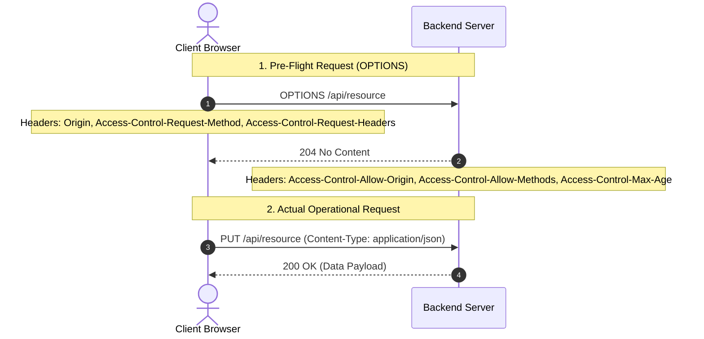

---

> [!abstract] Overview These detailed notes cover **Video 5: Understanding HTTP for Backend Engineers** from the _Backend Tech_ series[1][2]. HTTP operates as the core application protocol for client-server communication across modern web architectures[2][3].

---

## **1. Core Architectural Principles of HTTP**

> [!info] Core Concept: Statelessness HTTP is fundamentally a **stateless protocol**[2]. The server treats every incoming request as an isolated, independent interaction with no memory of past exchanges[2][4].

- **Self-Contained Requests**: Every request must carry all necessary metadata, headers, URL parameters, and authentication credentials (such as cookies or bearer tokens) so the server can process it in isolation[2][5].
- **Architectural Benefits**:
    - **Simplicity**: Simplifies server architecture because application instances do not need to manage or retain session state in memory[5].
    - **Scalability**: Enables load balancers to distribute incoming requests arbitrarily across any available backend instance[5].
    - **Fault Tolerance**: A server crash or restart does not destroy user session state, as state is not locked to a single application instance[5].
- **Maintaining Continuity**: Stateful interactions (e.g., user logins, shopping carts) are built on top of HTTP using mechanisms like **cookies**, **server-side sessions**, or **JSON Web Tokens (JWTs)**[2].

> [!note] Client-Server Model Communication is **always initiated by the client** (such as a web browser, mobile application, or CLI tool)[3][7]. The server hosts resources and listens on a port, processing incoming requests and returning an appropriate response[3].

- **Layer 7 Protocol**: HTTP operates at the **Application Layer (Layer 7)** of the [[OSI Model]][8].
- **Transport Layer (Layer 4)**: Relies on **TCP (Transmission Control Protocol)** to guarantee reliable, ordered message delivery via a **3-way handshake**[7][8].

---

## **2. Evolution of HTTP Protocol Versions**

```
timeline
    title Evolution of HTTP Protocol Versions
    HTTP 1.0 : Opens a brand-new TCP connection for every single request/response pair
    HTTP 1.1 : Introduces persistent connections (`Connection: keep-alive`) &amp; chunked transfer encoding
    HTTP 2.0 : Introduces multiplexing over a single connection, binary framing, HPACK header compression, and server push
    HTTP 3.0 : Built on top of [[QUIC Protocol]] over UDP, eliminating head-of-line blocking

```

- **HTTP 1.0**: Opened a new TCP connection for every request/response pair, introducing significant setup latency[9].
- **HTTP 1.1**: Introduced **persistent connections** (`Connection: keep-alive`), allowing multiple sequential requests and responses over the same underlying TCP connection, as well as chunked transfer encoding[9][10].
- **HTTP 2.0**: Introduced **multiplexing** (concurrent requests/responses over a single connection), **binary framing** (replacing plain text), **HPACK header compression**, and server push[9].
- **HTTP 3.0**: Built on top of the **QUIC protocol over UDP**, eliminating TCP head-of-line blocking and providing faster connection establishment[9].

---

## **3. Anatomy of Raw HTTP Messages**

> [!example] Request Message Structure An HTTP request consists of three main parts separated by CRLF line breaks[11]:

1. **Request Line**: HTTP Method + Resource Path/URL + HTTP Version[11].
2. **Request Headers**: Key-value metadata pairs providing context[11][12].
3. **Empty Line**: Separates headers from the payload[11].
4. **Request Body** _(Optional)_: Payload containing data sent to the server[11].

```
POST /api/v1/books HTTP/1.1
Host: api.example.com
User-Agent: Mozilla/5.0
Content-Type: application/json
Content-Length: 48

{"title": "Clean Code", "author": "Robert Martin"}

```

> [!example] Response Message Structure An HTTP response consists of[11]:

1. **Status Line**: HTTP Version + Status Code + Reason Phrase[11].
2. **Response Headers**: Metadata describing server rules, caching, and payload format[11][12].
3. **Empty Line**: Separates headers from the payload[11].
4. **Response Body**: Data payload returned to the client[11].

```
HTTP/1.1 200 OK
Date: Wed, 07 Oct 2026 03:44:20 GMT
Content-Type: application/json
Content-Length: 52

{"status": "success", "data": {"id": 101, "title": "Clean Code"}}

```

---

## **4. HTTP Headers & Categorization**

Headers act as key-value metadata that serve as a **remote control** for client-server interactions, directing how messages should be processed, cached, or secured[12][13].

|Category|Description|Key Examples|
|---|---|---|
|**Request Headers**[14]|Client context sent to the server[14].|`User-Agent`, `Authorization`, `Accept`[14]|
|**General Headers**[15]|Metadata applicable to both requests and responses[15].|`Date`, `Cache-Control`, `Connection`[15]|
|**Representation Headers**[15]|Describes body payload format, size, and encoding[15].|`Content-Type`, `Content-Length`, `Content-Encoding`, `ETag`[15]|
|**Security Headers**[16]|Browser-enforced security policies[16].|`Strict-Transport-Security` (HSTS), `Content-Security-Policy` (CSP), `X-Frame-Options`, `X-Content-Type-Options`[16]|

---

## **5. HTTP Methods & Idempotency**

HTTP methods express the explicit **intent** or action to be performed on a resource[17][18].jjjk

> [!info] Concept: Idempotency An operation is **idempotent** if executing it multiple times produces the exact same side effects on the server state as executing it once[19].

|Method|Semantic Purpose|Payload Body?|Idempotent?|Safe?|
|---|---|---|---|---|
|**GET**[20]|Retrieves a representation of a resource[20].|No[21]|**Yes**[19]|**Yes**[20]|
|**POST**[20]|Creates a new resource or triggers a custom action[20][22].|Yes[20]|**No**[23]|**No**[20]|
|**PUT**[20]|Completely replaces a target resource[19][20].|Yes[20]|**Yes**[19]|**No**[20]|
|**PATCH**[20]|Partially updates an existing resource[20].|Yes[20]|**Yes** / Depends|**No**[20]|
|**DELETE**[19]|Removes a resource at a target URL[19].|Optional|**Yes**[19]|**No**[19]|
|**OPTIONS**[24]|Queries server capabilities for [[CORS]] pre-flight checks[24][25].|No[25]|**Yes**|**Yes**|

---

## **6. Same-Origin Policy (SOP) & CORS**

> [!warning] Security Policy: SOP The **Same-Origin Policy (SOP)** is a browser security mechanism that restricts scripts on one origin from accessing resources on a different origin[24]. An **Origin** is defined by `Protocol + Domain + Port`[26].

### **Cross-Origin Resource Sharing (CORS)**

CORS provides a standardized mechanism for servers to explicitly grant cross-origin access via specific HTTP headers[24][27].



- **Simple Request**: Triggered directly for simple methods (`GET`, `POST`, `HEAD`) with default headers and simple content types[27]. The server must return `Access-Control-Allow-Origin`[27][28].
- **Pre-Flight Request**: Triggered automatically when using custom headers (`Authorization`), non-simple content types (`application/json`), or non-simple HTTP verbs (`PUT`, `DELETE`)[29][30]. Uses `OPTIONS` to verify permissions before the browser issues the actual payload[25].

---

## **7. Standard HTTP Status Codes**

Status codes are 3-digit standardized integers categorized by their leading digit[33][34]:

### **1xx: Informational**[34]

- `100 Continue`: Server received headers; client should proceed to send the request body[35].
- `101 Switching Protocols`: Server is switching protocols (e.g., upgrading to [[WebSockets]])[35].

### **2xx: Success**[34]

- `200 OK`: Standard successful HTTP interaction[35].
- `201 Created`: Resource successfully created (used in `POST` responses)[36].
- `204 No Content`: Request succeeded, but the response body is intentionally empty (used in `DELETE` or CORS pre-flights)[25][36].

### **3xx: Redirection**[34]

- `301 Moved Permanently`: Resource permanently relocated to a new URL[36].
- `302 Found / Temporary Redirect`: Resource temporarily relocated[37].
- `304 Not Modified`: Cached version remains valid; no response body returned[38][39].

### **4xx: Client Errors**[34][38]

- `400 Bad Request`: Payload validation, syntactic, or formatting error[38][40].
- `401 Unauthorized`: Authentication credentials missing, expired, or invalid[40].
- `403 Forbidden`: Authenticated, but user lacks necessary permissions[40][41].
- `404 Not Found`: Target URL or resource does not exist[41].
- `405 Method Not Allowed`: HTTP verb not supported for the target route[41].
- `409 Conflict`: Request conflicts with current server state (e.g., duplicate unique record)[42].
- `429 Too Many Requests`: Client exceeded rate limits[42].

### **5xx: Server Errors**[34][43]

- `500 Internal Server Error`: Unhandled server exception or unexpected failure[43].
- `501 Not Implemented`: Requested feature/method not supported[43].
- `502 Bad Gateway`: Proxy/reverse proxy received an invalid response from upstream[44].
- `503 Service Unavailable`: Server down or overloaded[44].
- `504 Gateway Timeout`: Proxy/reverse proxy timed out waiting for upstream server[44].

---

## **8. HTTP Caching & Conditional Requests**

> [!tip] Performance Optimization Caching reduces bandwidth and server load by reusing stored response representations[45].

- **Key Directives & Identifiers**: `Cache-Control` (`max-age`, `no-cache`), `ETag` (unique hash fingerprint), and `Last-Modified`[15][46].
- **Conditional Request Flow**:
    
    1. **First Request**: Client fetches resource. Server responds with `200 OK`, `ETag: "v1-hash"`, and `Cache-Control: max-age=10`[46].
    2. **Subsequent Revalidation**: When local cache expires, client issues conditional headers: `If-None-Match: "v1-hash"` or `If-Modified-Since`[47].
    3. **Server Evaluation**:
    
    - **Unchanged**: Server returns `304 Not Modified` with **zero body**, instructing client to reuse local cache[39][47].
    - **Modified**: Server returns `200 OK` with a **new payload** and updated `ETag`[48].

---

## **9. Content Negotiation & Data Compression**

- **Content Negotiation**: Allows client and server to agree on optimal data formats using `Accept` (`application/json`, `application/xml`), `Accept-Language`, and `Accept-Encoding`[49][50].
- **Data Compression**: Server compresses responses using `gzip`, `deflate`, or `br` when `Accept-Encoding` is specified[50][51].
    - _Impact_: Compressing a large 11,000-entry JSON file reduces bandwidth usage from **26 MB down to 3.8 MB**[52][53].

---

## **10. Large Payloads & Response Streaming**

- **Multipart Uploads**: Uses `Content-Type: multipart/form-data; boundary=----BoundaryString` to upload binary files divided into delimited sections[54][55].
- **Server-Sent Events (SSE) / Streaming**: Uses `Content-Type: text/event-stream` and `Connection: keep-alive` to stream continuous data events over a single open HTTP connection[56][57].

---

## **11. Transport Security (HTTPS)**

- **SSL (Secure Sockets Layer)**: Legacy cryptographic protocol, now deprecated due to vulnerabilities[57].
- **TLS (Transport Layer Security)**: Modern cryptographic protocol (TLS 1.3) providing **encryption**, **data integrity**, and **authentication**[57][58].
- **HTTPS**: Standard HTTP running over an encrypted TLS connection[58].