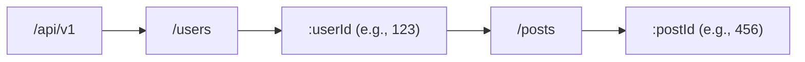
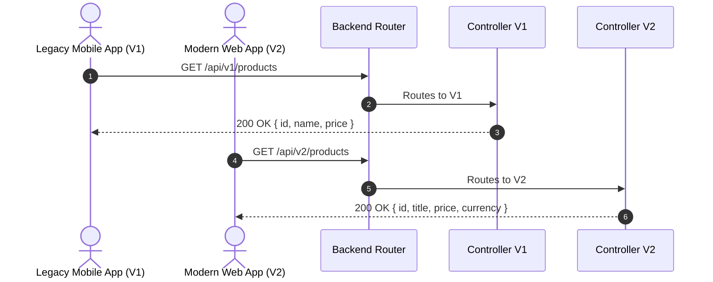
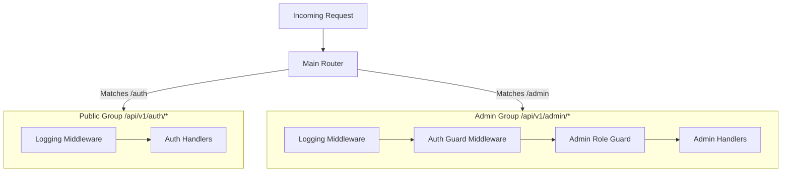
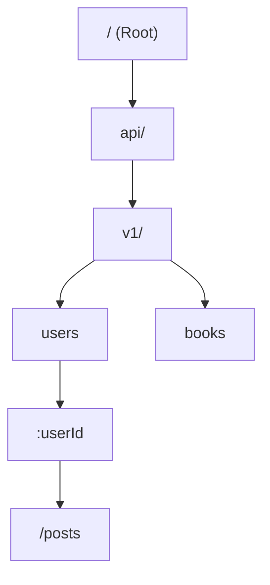

---

> [!abstract] Overview
> These detailed study notes cover **Video 6: What is Routing in Backend? How Requests Find Their Way Home** from the *Backend Tech* series. Routing serves as the central traffic controller of any backend application, mapping incoming HTTP requests (Method + Path) directly to specific server-side execution logic (Handlers/Controllers).

---

## 1. Core Definition & Fundamentals of Backend Routing

> [!info] Core Concept: The "What" vs. The "Where"
> An HTTP request consists of two primary operational components:
> 1. **HTTP Method (The "WHAT")**: Expresses the **intent** or action to be performed (e.g., `GET` to fetch, `POST` to create, `PATCH` to update, `DELETE` to remove).
> 2. **Route / Path (The "WHERE")**: Specifies the **target resource** or address on the server where the action should take place.

Routing is the process of mapping the combination of an **HTTP Method** and a **URL Path** to a specific server-side function, known as a **Handler** or **Controller**.

```mermaid
flowchart LR
    subgraph Client
        req[HTTP Request<br><code>GET /api/v1/books</code>]
    end

    subgraph Backend Server
        router{Router / Dispatcher}
        h1["Handler 1: listBooks()"]
        h2["Handler 2: createBook()"]
        h3["Handler 3: getUser()"]
    end

    req -->|1. Incoming Request| router
    router -->|2. Matches GET + /api/v1/books| h1
    router -.-x|Mismatch| h2
    router -.-x|Mismatch| h3
````

The Lookup Key

Inside the application runtime, the router constructs a compound key combining the HTTP verb and path string: $$\text{Lookup Key} = \text{HTTP\_METHOD} + \text{" "} + \text{PATH\_STRING}$$

- `GET /api/v1/books` $\rightarrow$ Maps to `listBooksHandler()`
- `POST /api/v1/books` $\rightarrow$ Maps to `createBookHandler()`

Even if two requests share the exact same URL path, using different HTTP methods ensures they route to entirely different handlers without collision.

---

2. Route Classifications & Path Parameters

Routes are broadly classified based on whether their URL paths are fixed or variable.

```mermaid
graph TD
    A[Route Types] --> B[Static Routes]
    A --> C[Dynamic Routes]
    B --> B1["Fixed String:<br><code>/api/v1/books</code>"]
    C --> C1["Path Parameters:<br><code>/api/v1/users/:id</code>"]
    C --> C2["Nested Routes:<br><code>/users/:userId/posts/:postId</code>"]
    C --> C3["Wildcard / Catch-All:<br><code>/api/*</code>"]
```

Static Routes

- **Definition**: Routes with explicit, fixed path strings containing zero variable segments.
- **Example**: `GET /api/v1/books` or `POST /api/v1/organizations`
- **Behavior**: The incoming URL string must match the registered string character-for-character.

Dynamic Routes & Path Parameters

- **Definition**: Routes that contain variable placeholders embedded within the URL path segments.
- **Terminology**: The embedded variables are called **Path Parameters** (or Route Parameters).
- **Syntax Conventions**:
    - Express/Node.js / Go / General: `/api/v1/users/:id`
    - OpenAPI / OpenAPI Spec: `/api/v1/users/{id}`

>[!info] Path Parameter Extraction & String Casting When a request like `GET /api/v1/users/123` hits the router:
>1. The router identifies `/123` as matching the `:id` segment placeholder.
>2. It extracts `"123"` and populates it into the request parameter map (e.g., `req.params.id`).
>3. **Crucial Rule**: All path parameters are extracted natively as **strings**, regardless of whether they represent numbers or UUIDs. Type transformation/casting must happen during validation.

```
GET /api/v1/users/123 HTTP/1.1
Host: api.example.com
```

```
// Example Router Handler matching /api/v1/users/:id
app.get('/api/v1/users/:id', (req, res) => {
    const userId = req.params.id; // Extracted as String "123"
    // Pass userId to service layer for database lookup
});
```

---

3. Query Parameters vs. Path Parameters

Backend applications frequently need to receive extra parameters from the client. The choice between Path Parameters and Query Parameters depends on semantic intent.

[!example] Anatomy of Query Parameters Query parameters appear after a `?` delimiter in the URL, formatted as `key=value` pairs separated by `&`. `GET /api/v1/books?page=2&limit=20&sort_by=created_at&sort_order=desc`

|Feature|Path Parameters (`/users/:id`)|Query Parameters (`/users?status=active`)|
|---|---|---|
|**Location**|Embedded inside the URL path string.|Appended after the `?` query string delimiter.|
|**Semantic Role**|Identifies a **specific resource** or exact node in the hierarchy.|Modifies, **filters, sorts, or paginates** a collection of resources.|
|**Required vs. Optional**|**Mandatory**: Omitting a path segment breaks route matching.|**Optional**: The server should supply sensible defaults if omitted.|
|**Typical HTTP Method**|`GET`, `PUT`, `PATCH`, `DELETE`|Primarily `GET` (since `GET` requests lack a body payload).|
|**Examples**|`/books/101`, `/orders/8849`|`?page=1&limit=10`, `?search=laptop`, `?status=archived`|

>[!tip] Best Practice for Query Parameters Always make query parameters **optional** in your API design. When clients omit query parameters (e.g., `GET /api/v1/books`), the backend should apply safe defaults:- 
>-Default `page` = `1`
>- Default `limit` = `10` or `20`
>- Default `sort_by` = `created_at`
>- Default `sort_order` = `desc`

---

4. Nested & Hierarchical Routing

[!info] Semantic Hierarchy A forward slash (`/`) in an API route represents a **hierarchical parent-child relationship** between resources in the underlying domain model.

When resources naturally belong to other resources (e.g., a user owns multiple posts, or an organization contains multiple projects), route paths should reflect this hierarchy through **Nested Routing**.



Hierarchy Deconstruction Example

Path: `GET /api/v1/users/123/posts/456`

1. `/users`: Accesses the global collection of `users`.
2. `/users/123`: Scopes down to a single user resource identified by ID `123`.
3. `/users/123/posts`: Accesses the sub-collection of `posts` owned specifically by user `123`.
4. `/users/123/posts/456`: Scopes down to a specific post identified by ID `456` belonging to user `123`.

```
GET /api/v1/users/123/posts/456 HTTP/1.1
Host: api.example.com
```

- **Handler Responsibilities**: The controller extracts both `userId` (`123`) and `postId` (`456`), verifying that post `456` indeed belongs to user `123` before returning the resource.

---

5. Catch-All / Wildcard Routes & Error Handling

>[!warning] Fallback Route Handling If a client requests a route that has not been explicitly registered in the routing table (e.g., `GET /api/v1/unknown-endpoint`), the default router behavior might terminate the connection ungracefully or return raw framework HTML error pages.

To prevent unhandled route execution, production routers implement a **Catch-All (Wildcard) Route** registered at the very end of the routing tree.

```
// Registered LAST in the routing declaration order
app.all('*', (req, res) => {
    res.status(404).json({
        status: "error",
        code: "ROUTE_NOT_FOUND",
        message: `The requested endpoint ${req.method} ${req.originalUrl} does not exist on this server.`
    });
});
```

- **Wildcard Syntax**: Often uses `*` or `/*path` depending on the framework.
- **Execution Rule**: Evaluated **only after** all preceding static and dynamic route evaluations have failed to match.
- **Return Code**: Always returns an explicit `404 Not Found` JSON status payload.

---

6. API Route Versioning & Deprecation Strategies

As application requirements evolve, changing existing response keys or parameter types introduces **breaking changes** for active client applications (e.g., web frontends, mobile apps, third-party integrations).

URI Path Versioning

The industry-standard approach incorporates version prefixes directly into the route path segment:

- Version 1 Path: `GET /api/v1/products` $\rightarrow$ Returns `{ id, name, price }`
- Version 2 Path: `GET /api/v2/products` $\rightarrow$ Returns `{ id, title, price, currency }`



Graceful Deprecation Workflow

1. **Introduction**: Release `/v2/` alongside `/v1/`.
2. **Notification**: Mark `/v1/` routes as deprecated in [[OpenAPI]] specifications and attach response headers (e.g., `Deprecation: true`, `Sunset: Wed, 11 Nov 2026 00:00:00 GMT`).
3. **Migration Window**: Give frontend and integration teams a dedicated grace period to update their client API calls to `/v2/`.
4. **Sunsetting**: Decommission the `/v1/` handlers and convert `/v1/` paths to return `410 Gone` or `404 Not Found`.

---

7. Route Grouping & Shared Middleware Pipeline

Modern backend frameworks support **Route Grouping** (or Modular Routers) to organize endpoints into logical sub-trees and attach shared [[Middlewares]] to specific prefixes.



Advantages of Route Grouping

- **Dry Codebase**: Avoids re-attaching authentication guards or logging functions to every route individually.
- **Prefix Isolation**: Groups all endpoints belonging to a domain module (e.g., `/organizations`, `/projects`, `/tasks`).
- **Shared Scope**: Applies middleware chains exclusively to targeted sub-paths.

---

8. Under the Hood: Router Matching Algorithms & Data Structures

>[!tip] Performance Engineering: How Routers Scale A naive router implementation iterates through an array of registered routes sequentially ($O(N)$ time complexity). In a production backend with 500+ endpoints, checking every path string sequentially for every request introduces severe latency.

To achieve $O(K)$ **lookup performance** (where $K$ is the length of the path URL string, independent of total route count $N$), modern routers utilize a **Radix Tree** (or Compact Prefix Trie).



Data Structure Comparison

|Algorithm / Data Structure|Time Complexity|Pros|Cons|
|---|---|---|---|
|**Linear Array Scan**|$O(N)$|Extremely simple to write.|Horrible performance as route count $N$ grows.|
|**Hash Table Exact Match**|$O(1)$|Instant exact string matching.|Cannot match dynamic path parameters (`:id`) or wildcards (`*`).|
|**Regular Expressions (Regex)**|$O(K \times N)$|Highly flexible and expressive pattern matching.|Computationally expensive and CPU-intensive under high throughput.|
|**Radix Tree (Prefix Trie)**|$O(K)$|**Blazingly Fast**: Matches static, dynamic, and wildcard routes in linear time relative to path length $K$.|