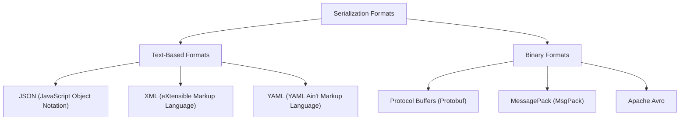
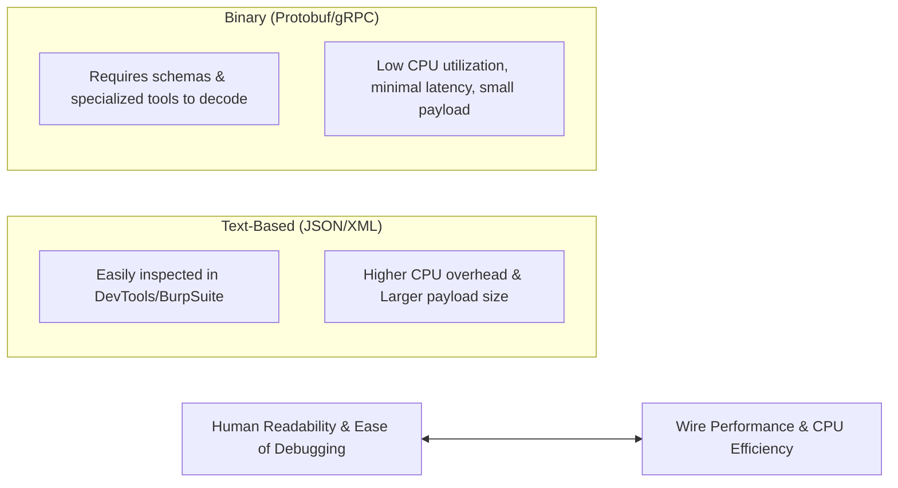
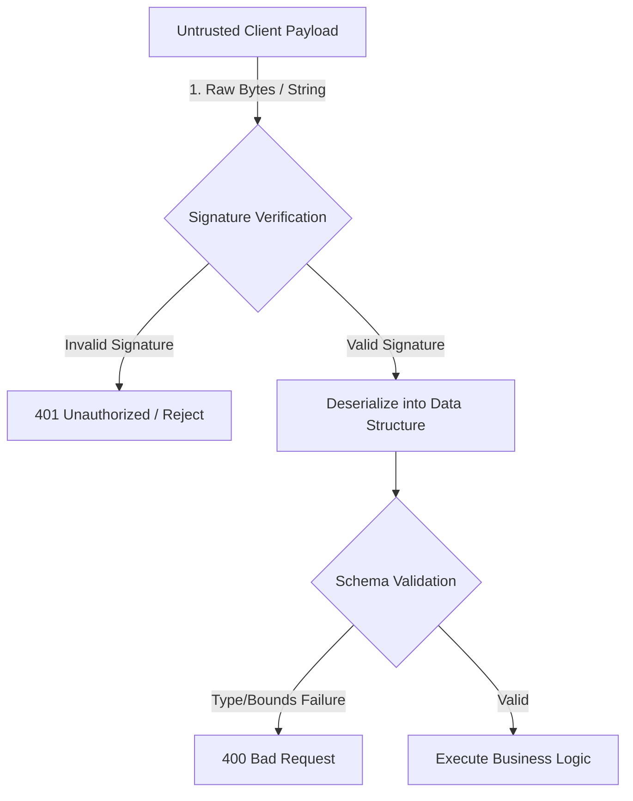

> [!abstract] Overview
> These exhaustive study notes cover **Video 7: Serialization and Deserialization for Backend Engineers** from the *Backend Tech* series [1]. Serialization and deserialization form the universal data bridge allowing heterogeneous client-server systems (e.g., a JavaScript browser frontend and a Rust/Go backend) to exchange structured data over the network or persist it on disk in a language-agnostic format [2-4].

---

### 1. Fundamental Concepts & Definitions

> [!info] Core Definitions
> * **Serialization**: The process of converting in-memory, language-native data structures (e.g., Go structs, Python dictionaries, Rust structs, or JavaScript objects) into a standardized, transferable format (text or binary) suitable for transmission over a network or storage on disk [4-6].
> * **Deserialization (Data Binding / Unmarshalling)**: The inverse process of taking incoming raw serialized bytes/text received over the network or disk and parsing them back into native in-memory data structures that the target programming language can understand and process [4-7].

```mermaid
graph LR
    subgraph Client ["Client Runtime (e.g. JavaScript)"]
        jsObj["JS Object<br>{ name: 'Alice' }"]
    end
    
    subgraph Network ["Wire Transport"]
        wire["Serialized Format (JSON/Protobuf)<br><code>'{ &quot;name&quot;: &quot;Alice&quot; }'</code>"]
    end

    subgraph Server ["Server Runtime (e.g. Go / Rust)"]
        nativeStruct["Native Struct / Dict<br><code>type User struct { Name string }</code>"]
    end

    jsObj -->|1. Serialization| wire
    wire -->|2. Deserialization / Binding| nativeStruct
    nativeStruct -->|3. Business Logic / DB| nativeStruct
    nativeStruct -->|4. Response Serialization| wire
    wire -->|5. Client Deserialization| jsObj
````

Why Do We Need Serialization?

In modern web architectures, clients and servers are built using entirely different programming languages and execution runtimes12:

- **Client Side**: Dynamically typed, interpreted environments like JavaScript/TypeScript running in browser sandboxes12.
- **Server Side**: Strictly typed, compiled runtimes like Go, Rust, Java, or C++, or dynamic environments like Python and Ruby23.

Because memory layouts, byte alignments, and type systems differ completely across programming languages, a Go `struct` cannot be sent directly across memory addresses to a JavaScript engine23. Serialization establishes a **Language-Agnostic Standard** (a universal contract)4more_horiz: $$\text{Native Data Structure} \xrightleftharpoons[\text{Deserialization}]{\text{Serialization}} \text{Universal Format (Wire / Storage)} \xrightleftharpoons[\text{Deserialization}]{\text{Serialization}} \text{Target Native Data Structure}$$

---

### 2. OSI Model Mental Model & Request Life Cycle

>[!tip] Mental Model for Backend Engineers At the [[OSI Model]] layer breakdown, serialization operates at **Layer 7 (Application Layer)**8more_horiz.
>- **The Wire Abstraction**: Downstream transport layers convert the serialized string/bytes into TCP segments, IP packets, frames, and physical electrical/optical bits ($0$s and $1$s)8more_horiz.
>- **Backend Boundary**: As a backend engineer, your responsibility starts when the operating system and web server receive the network bits, reconstruct the raw HTTP request body, and present the raw serialized payload (e.g., raw JSON string) to your application layer810.

```mermaid
sequenceDiagram
    autonumber
    actor Client as Client (Browser / App)
    participant Middleware as Parser / Binding Middleware
    participant Controller as Handler / Controller
    participant Validator as Validation & Transformation
    participant Service as Business Logic / Service
    participant Database as Database / Repository

    Client->>Middleware: Raw HTTP Request (Serialized JSON Body)
    Note over Middleware: Deserialization / Data Binding
    alt Deserialization Failure (Malformed JSON)
        Middleware-->>Client: 400 Bad Request (Short-Circuit) [7]
    else Deserialization Success
        Middleware->>Controller: Native Struct / Class / Dict [6, 13]
        Controller->>Validator: Syntactic & Semantic Checks [13, 14]
        Validator->>Service: Validated Domain Object [15]
        Service->>Database: Repository Persistence Query [16]
        Database-->>Service: Query Result Set
        Service-->>Controller: Domain Response Object
        Note over Controller: Response Serialization
        Controller-->>Client: 200 OK / 201 Created (Serialized Payload) [17, 18]
    end
```

Handler & Middleware Responsibilities

1. **Data Extraction & Binding**: Upon route matching, the first operational step is extracting the request body/parameters and deserializing them into native structs/classes3more_horiz.
    - In frameworks like Express/Node.js, upstream body-parser middlewares (`express.json()`) automatically parse JSON into JavaScript objects prior to reaching route handlers3.
    - In compiled languages like Go, Rust, or Python (FastAPI/Pydantic), explicit binding functions (e.g., `json.Unmarshal()` or `c.ShouldBindJSON()`) parse the JSON stream into concrete typed structs3.
2. **Early Termination on Failure**: If deserialization fails due to syntax errors (e.g., trailing commas, unclosed quotes, type mismatches), the server **must fail fast**, returning an HTTP `400 Bad Request` status code immediately without forwarding execution to business logic or database layers11.

---

### 3. Data Format Categories: Text-Based vs. Binary

Serialization formats fall into two broad architectural categories: **Text-Based Formats** and **Binary Formats**514.



Comprehensive Comparison Matrix

|Feature / Metric|JSON|XML|YAML|Protocol Buffers (Protobuf)|MessagePack|
|---|---|---|---|---|---|
|**Format Type**|Text-Based514|Text-Based514|Text-Based514|Binary Format514|Binary Format5|
|**Human Readability**|High1516|High|High (Comments supported)|Zero (Raw byte stream)15|Zero (Raw byte stream)|
|**Payload Size**|Moderate / Verbose15|Heavy (Closing tags)|Moderate|**Extremely Compact**15|Compact|
|**Parsing Speed**|Fast (Native in JS)317|Slow|Slow|**Blazingly Fast (CPU Efficient)**15|Fast|
|**Schema Requirement**|Optional (JSON Schema)15|Optional (XSD)|Optional|**Mandatory** (`.proto` files)|Optional|
|**Comments Support**|❌ No|Yes|Yes|Yes (in `.proto`)|❌ No|
|**Primary Use Cases**|REST APIs, Configs, Logs5more_horiz|Legacy APIs, SOAP, Feeds514|DevOps, K8s, Configs19|gRPC, Microservices, IPC5more_horiz|High-throughput Caching|

---

4. Deep Dive: Text-Based Formats

5. JSON (JavaScript Object Notation)

JSON is the undisputed industry standard for web browser to server REST API communications, accounting for over 80% of web traffic1318.

>[!info] JSON Syntax Rules & Primitive Types JSON enforces a strict subset of JavaScript object literal syntax17more_horiz:

1. Payload must be enclosed in curly braces `{}` for objects or square brackets `[]` for arrays1621.
2. **All keys MUST be enclosed in double quotes** **""** (single quotes are invalid)21.
3. Supported primitive data types: `string`, `number` (integer/float), `boolean` (`true`/`false`), `null`, `array`, and nested `object`5more_horiz.

```
{
  "id": 101,
  "title": "Backend Engineering",
  "isPublished": true,
  "tags": ["architecture", "http"],
  "author": {
    "name": "Sriniously",
    "email": "author@example.com"
  },
  "metadata": null
}
```

>[!tip] JSON Field Naming Conventions In standard API design, JSON keys **MUST follow camelCase** (e.g., `isPublished`, `createdPage`) to align with JavaScript/TypeScript frontend standards22. When mapping to backend structs using `snake_case` database schemas, use language field tags (e.g., Go `json:"is_published"`) for conversion323.

2. XML & YAML

- **XML**: Historically dominant in enterprise architectures (SOAP APIs). Extremely verbose due to repeated opening and closing tags (`<author>Name</author>`), increasing network bandwidth consumption514.
- **YAML**: Popular in configuration management (e.g., Docker Compose, Kubernetes manifests) because it supports inline comments and clean indentation, but unsuitable for high-throughput network payloads due to complex whitespace parsing1419.

---

## 5. Deep Dive: Binary Formats (Protobuf & MessagePack)

Binary formats eliminate human-readable text strings altogether, encoding data directly into compact byte arrays1415.

```
// Protocol Buffer Schema Definition (.proto)
syntax = "proto3";

message UserProfile {
  int32 id = 1;          // Field tag 1
  string name = 2;        // Field tag 2
  string email = 3;       // Field tag 3
  bool is_active = 4;     // Field tag 4
}
```

>[!info] How Protobuf Achieves Extreme Efficiency

1. **Field Tags Instead of Key Strings**: Instead of transmitting the string `"is_active"` repeatedly over the wire, Protobuf transfers a numeric field tag (`4`). This reduces key overhead from 9 bytes down to a single byte15.
2. **Varints & ZigZag Encoding**: Numbers are compressed using variable-width integer encoding (small numbers like `1` take 1 byte instead of 4 or 8 bytes)15.
3. **Zero Parsing Overhead**: The CPU does not need to parse string tokens, look for quotes, or scan for delimiters. It reads byte offsets directly into memory1524.

---
### 6. Trade-Off Analysis: Readability vs. Performance

>[!warning] The Fundamental Engineering Trade-Off Selecting a serialization format represents a direct trade-off between **Developer Ergonomics (Readability & Debuggability)** and **System Performance (CPU, Memory, and Network Bandwidth)**15.



1. Network Bandwidth Overhead

Text formats repeat dictionary keys in every single message. If an API returns an array of 10,000 objects where every object contains keys like `"created_at_timestamp"`, that key string is transmitted 10,000 times15more_horiz.

- _Mitigation for JSON_: Combining text JSON with network stream compression ([[HTTP#9. Content Negotiation & Data Compression|Gzip / Brotli]]) can compress a 26 MB raw JSON response down to 3.8 MB2527.

2. CPU & Memory Overhead

In high-throughput microservices or IO-bound systems, profiling often reveals that **JSON serialization and string parsing are the actual CPU bottlenecks**—not database queries24more_horiz!

- Converting numbers to ASCII strings during serialization, and scanning string tokens during deserialization, consumes significant CPU cycles and triggers frequent garbage collection allocations2430.

---

### 7. Common Serialization Errors & Edge Cases

When handling JSON payloads in production backends, applications encounter several edge cases15:

1. Missing vs. Extra Fields

- **Extra Fields**: Clients might submit unexpected keys. Strict backends reject these with validation errors; forgiving backends ignore unknown keys15.
- **Missing Fields**: If mandatory keys are omitted, deserializers bind them to language default zero-values (`0`, `""`, `false`, or `nil`/`null`), which can bypass logic unless validated2315.

2. Null Values vs. Omitted Values

- `{"status": null}` implies an explicit assignment of `null`.
- `{}` (omitted key) implies no update provided.
- _Language Handling_: Dynamically typed languages handle this natively, whereas statically typed languages require pointer fields or optional types (e.g., `*string` in Go or `Option<String>` in Rust) to differentiate `null` from missing values315.

3. Date, Time & Timezone Serialization

JSON lacks a native Date data type1516. Dates are serialized as ISO 8601 strings (`"2026-10-07T03:44:20Z"`) or UNIX timestamps (`1791344660`).

- _Common Bug_: Serializing dates in local server timezones instead of standardized **UTC**, leading to time-skew inconsistencies across international clients15.

---

### 8. Security & Insecure Deserialization

>[!danger] Security Vulnerability: Insecure Deserialization Deserializing untrusted data from an external client without prior validation creates severe security vulnerabilities, including **Remote Code Execution (RCE)** and **Object Injection Attacks**1531.



Security Best Practices

1. **Verify Before Deserializing**: When receiving signed payloads (e.g., Webhooks with HMAC signatures), **always compute and verify the cryptographic signature over raw request bytes FIRST** before attempting to parse or deserialize the JSON payload3233.
2. **Schema Validation (JSON Schema / Zod)**: Enforce strict type validation, string length limits, numeric bounds, and regex pattern matching immediately post-deserialization23more_horiz.
3. **Avoid Dynamic Class Instantiation**: Never use dangerous native deserializers (e.g., Python `pickle` or Java native object streams) on untrusted client inputs31.

---

### 9. Real-World Applications Beyond HTTP

Serialization is not limited to client-server API requests—it powers core backend infrastructure16:

- **Task Queues & Background Workers**: Producers serialize background jobs (e.g., email payloads) into JSON strings before pushing them into message brokers like Redis, RabbitMQ, or AWS SQS. Consumers pull and deserialize these payloads into native structures34more_horiz.
- **In-Memory Caching (Redis)**: Database query results or user sessions are serialized into JSON strings or binary representations before being stored under key-value pairs in RAM3839.
- **Database JSON Data Types**: PostgreSQL provides native `JSON` (stored as raw text) and `JSONB` (deconstructed into a decomposed binary format for fast indexing and querying without runtime string parsing)